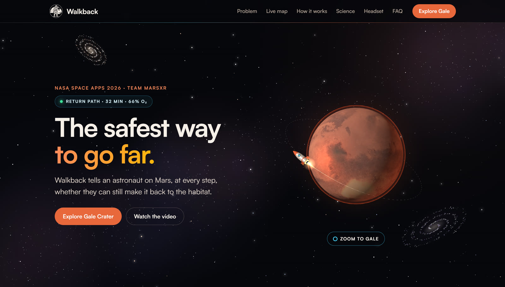
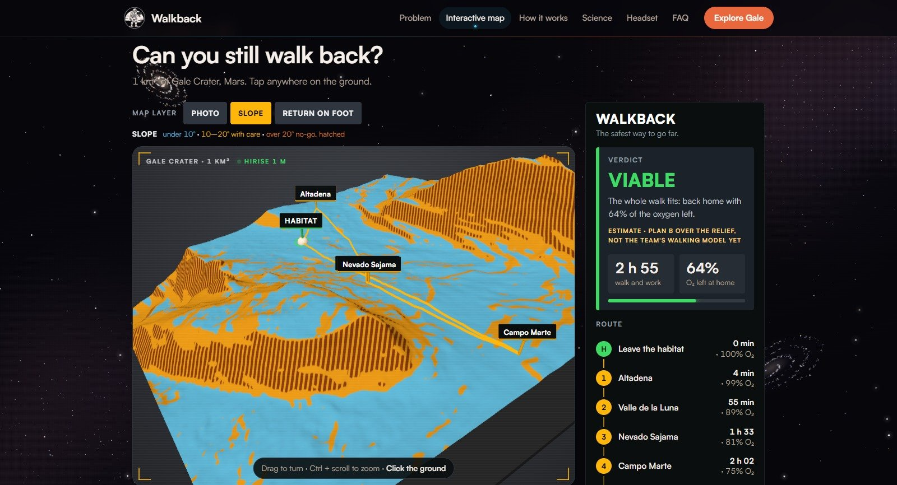
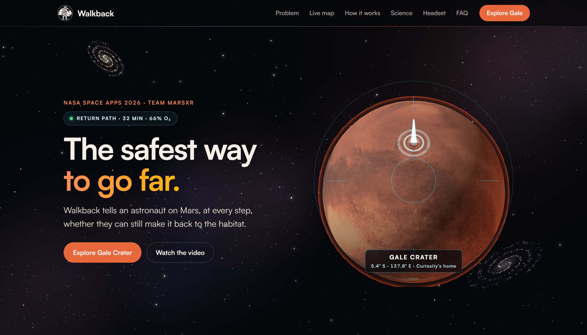

<p align="center">
  
</p>

<h1 align="center">Walkback</h1>

<p align="center"><b>The safest way to go far.</b></p>

<p align="center">
  <a href="https://youtu.be/3ttjGnluXzw"><b>▶ Watch the demo</b></a> ·
  <a href="https://github.com/kendal-dev/Walkback/releases/tag/v1.0-submission"><b>⬇ Quest 3 APK (v1.0-submission)</b></a> ·
  <a href="#the-web-page"><b>🌐 The web page</b></a> ·
  <a href="DATA.md"><b>📡 Data</b></a>
</p>

<p align="center">
  
  
  
  
  
</p>

Walkback is a mixed-reality prototype for Meta Quest 3 that tells an astronaut on Mars, at every step, whether they can still make it back to the habitat. Meta Quest 3 stands in for the helmet display.

Built by team MARSXR for the NASA International Space Apps Challenge 2026, Santa Cruz (Bolivia) local event, for the challenge "Interplanetary Survival Guide: Martian Map". First place at the Santa Cruz local event (15 November 2026).

> NASA does not endorse this project. No NASA logo or insignia is used.
> Built with AI assistance (Claude Code; Codex and Antigravity for parts of the web page): see [AI_USAGE.md](AI_USAGE.md).

> **This is the `v1.1` branch, work in progress.** What NASA judges is version 1.0: the release `v1.0-submission` and the `main` branch, which this branch does not change. Version 1.1 adds, so far without being seen in the headset: a preview when pointing at a stop's pillar; a WHAT IF sign by the table, so the WHAT IF works with hands; stops the astronaut adds by tapping the map, with their minutes of work, REMOVE and CLEAR, kept between sessions; a card over the ground with the minutes back and the slope; the point of no return as a red pillar, on the visor's and the wrist's maps and as "turn back in N m" on the visor; planning on a worker thread; and an optional link to a NASA SUITS telemetry server (off by default). Every number is still the plan B estimate. The full list and what to check in the headset: [CHANGELOG-v1.1.md](CHANGELOG-v1.1.md).

---

## Demo video

[](https://youtu.be/3ttjGnluXzw)

*WALKBACK by MARSXR* on YouTube: [youtu.be/3ttjGnluXzw](https://youtu.be/3ttjGnluXzw)

---

## Two phases: plan, then explore

1. **Plan, at the table (mixed reality).** A square kilometre of Gale crater sits on a table in the room. The astronaut reads the ground with four layers, sees the route through four real Curiosity drill sites, and gets a verdict with its oxygen, time and height charts. The WHAT IF re-plans with less oxygen in the tank.
2. **Explore, on the terrain (Mars at 1:1).** START MISSION puts the astronaut on the same terrain at real scale, with the route on the ground, a pillar at each stop and a helmet visor that keeps the way back in view.

## What the app does today

- **Real Mars on the table.** A 1 km × 1 km square of Gale crater (centered at 4.807° S, 137.381° E), built from a 1 m HiRISE elevation model and the 25 cm HiRISE photo mosaic, sits on a table in the room (mixed reality, passthrough).
- **Four map layers:** PHOTO (the HiRISE photo on the relief), HEIGHT, SLOPE (ground over 20° hatched as no-go) and RETURN (minutes back to the habitat from every point of the map, over the relief).
- **Four stops**, all real Curiosity drill sites at the rover's own positions: Altadena, Valle de la Luna, Nevado Sajama and Campo Marte, each with a stop card (science, tasks with minutes, risk).
- **Route and verdict.** The app plans habitat → stops in order → habitat over the relief and shows a verdict card (VIABLE / NOT VIABLE / NO SAFE ROUTE) with three charts: oxygen tank (used / spare / reserve), time (walking and work), and height along the route.
- **WHAT IF.** The left stick click (or key F) re-plans with the tank at 15 %, then at 8 %, then back at 100 %. The verdict changes and the RETURN layer paints red the ground you can no longer walk back from. On this site (ESTIMATE): at 15 % the verdict is NOT VIABLE but nothing is red yet; at 8 %, 57.5 % of the ground that has a way back on foot is red.
- **Globe and 360° photo.** A Mars globe (Viking colour mosaic) to land on the site, and Curiosity's Mastcam 360° panorama at Nevado Sajama (the 360° PHOTO button on that stop's card; the other three stops have no panorama and their cards say so).
- **Helmet visor (HUD):** compass tape, heading, an arrow to the next stop, an oxygen bar with the reserve mark, minutes back to the habitat in green / amber / red, a two-beep alert when TURN BACK NOW comes on, a 2D corner map and a 3D wrist map that can be left in the air (X).
- **Mission mode:** START MISSION on the verdict card takes you onto Mars at 1:1 scale (the same terrain mesh and photo), with the route on the ground, a pillar and an arrival card at each stop, jumps to the next stop (NEXT STOP sign, or left grip) and a room view (the visor and the route over the real floor). *Run in the headset on 15 Nov 2026: Mars at 1:1 at 72 fps, the room view and the way back to the table. Jumps between stops, the arrival card and TURN BACK NOW were not yet tried there (see the status table).*
- **Current conditions card.** The latest Curiosity REMS weather report (sol 4995, Earth date 2026-08-25), season, daylight, surface radiation and the week's space weather, each with its source and date. The card is stored in the app. One line can be newer: at start, if the headset has internet, the app asks NASA DONKI once for the solar particle events of the last 7 days (public DEMO_KEY, 4 s limit) and marks that line "(live)" with the time of the check; with no usable answer it keeps the stored line, marked "(stored in the app)". The weather report is never downloaded live, and **nothing on this card feeds the oxygen estimate.**

### Every number is an estimate

The walking and oxygen model of the team is not in the app yet. The app uses a stand-in ("plan B") and says ESTIMATE next to its numbers on screen: under the verdict (*ESTIMATE: plan B over the relief, not the walking model yet*), in the chart titles, on the visor and in the RETURN layer's legend.

Today's mission plan (ESTIMATE: plan B over the relief, not the walking model yet):

| Quantity | Value (ESTIMATE) |
|---|---|
| Route length | 1.8 km (1812 m) — ESTIMATE |
| Walking time | 43 min — ESTIMATE |
| Work at the four stops | 2 h 12 min — ESTIMATE |
| Total time | 2 h 55 min — ESTIMATE |
| Oxygen used | 181 L of O₂ = 36 % of the tank — ESTIMATE |
| Spare above the reserve | 285 L — ESTIMATE |

How plan B works: each leg is the fastest way over the relief (Dijkstra on the elevation grid, pace by Tobler's hiking function normalised to a flat-ground pace, no step on ground over 20°), smoothed with straight shortcuts where they stay walkable; walking spends oxygen per minute walked, work at a stop spends it at the suit's design rate; the verdict is VIABLE only if, at every stop, the oxygen above the reserve still covers the way back. The constants and where they come from are listed in [NOTICE](NOTICE) (section "Walking and oxygen model").

---

## Status: what was seen in the headset

| Piece | Automatic test (no headset) | Seen in the Quest 3 |
|---|---|---|
| Gale terrain and the four layers | Passes | Yes (15 Nov, the build of 01:37, 72 fps) |
| Pointer, table, globe and jump into the 360° photo | Passes | Yes (15 Nov, 72 fps, with hand tracking) |
| Verdict board and charts, START MISSION | Passes | Yes (15 Nov) |
| Route over the relief (plan B) | Passes | Yes, on the table (15 Nov) |
| Helmet HUD, corner map, wrist map left in the air | Passes | Yes inside the 360° photo (15 Nov: its numbers matched the plan's); in mission mode it is on screen, its details not yet checked |
| Mission mode (Mars at 1:1, room view, back to the table) | Passes | Yes (15 Nov: entered at 03:41 and 03:53, and six more times between 09:08 and 09:35; the ROOM VIEW and BACK TO TABLE signs worked; every 10-second average on Mars was 70.6 to 72.0 fps) |
| Jumps between stops (NEXT STOP sign, left grip) | Passes | Yes (15 Nov, 09:08 to 09:35: nine jumps, eight with the NEXT STOP sign and one with the left grip, as far as the third stop, Nevado Sajama) |
| RECENTER sign in mission mode | Passes | Yes (15 Nov, 09:08 and 09:35: three presses, each logged as a recenter) |
| Arrival card, TURN BACK NOW | Passes | Not yet (no line for either in the 15 Nov logs) |
| WHAT IF (tank at 15 % and 8 %) | Passes | Not seen on 15 Nov (no WHAT IF line in the logs); seen on 14 Nov with an earlier build |
| Current conditions card | Passes | Yes: the space-weather line was read from NASA DONKI at start and marked "(live)" (15 Nov, 03:28 local time); at 09:06 and 09:34 NASA DONKI could not be read and the card kept the stored line, marked "(stored in the app)" |

This table is what the team saw on 15 Nov (local time), read from the app's own log lines: between 03:28 and 03:54 with the build of 01:37 (from commit `7addfa2`), using hand tracking; then between 09:06 and 09:22 (hand tracking) and between 09:34 and 09:36 (controllers) with an APK installed after 03:54. The logs do not name that later build; no file under `Assets/`, `ProjectSettings/` or `Packages/` changed on `main` after commit `7addfa2`. The APK in the [v1.0-submission release](https://github.com/kendal-dev/Walkback/releases/tag/v1.0-submission) was built later the same morning from commit `ee833af`: between those two commits no file under `Assets/`, `ProjectSettings/` or `Packages/` changed (only the presentation and the documentation), so it is the same app code as the builds in this table. Still to try: the WHAT IF in these builds, the arrival card, TURN BACK NOW, the jump to the last stop (Campo Marte) and the menu button (≡).

People at the venue: on 15 Nov about ten visitors at the Santa Cruz event asked to try the headset; the team let them and asked them for recommendations by word of mouth. It was informal (no tasks, no scores, no written notes), so this README reports no results from it.

---

## The web page

https://kendal-dev.github.io/Walkback/

`walkback-web/web/` is a static page for the jury and anyone without a headset: it opens in a phone or laptop browser and loads nothing from third parties (three.js and the fonts are copied in `vendor/`), so a local copy of the folder also works offline.

<p align="center">
  
</p>

- **Live map.** The real Gale square kilometre in 3D (real Gale data, plan B numbers marked ESTIMATE), with the headset's own layers and colours: PHOTO (the HiRISE photo on the relief), SLOPE (under 10° blue, 10–20° orange, over 20° hatched as no-go) and RETURN ON FOOT (minutes back to the habitat, a ring every few minutes). Tap the ground for the minutes and the oxygen back to the habitat; the verdict panel shows the headset's verdict, the mission's total time and the oxygen left, all marked ESTIMATE.
- **What if the tank ran low?** The same check as the headset's WHAT IF: with 15 % or 8 % of the tank, the ground you could no longer walk back from turns red. The page compares the return map's litres with the smaller tank; it computes no route or time of its own.
- **Zoom to Gale.** The hero's 3D Mars turns Gale crater to the front, swings below the planet and raises a pillar of light on the crater, then comes back. A small 3D rocket orbits the planet and hides behind it.
- **Enter VR.** In the Meta Quest browser, the page stands you at the habitat in Gale at real scale (WebXR).
- **Plus:** the mission plan with the four drill sites, how the data goes from orbit to litres of oxygen, the screens of the headset app, an FAQ, and an opening animation that can be skipped (and never plays when the system asks for less motion).

<p align="center">
  
</p>

Run it locally, and check it before publishing:

```bash
python -m http.server 8137 --directory walkback-web/web
node walkback-web/web/tools/check_web.mjs
```

Then open http://localhost:8137. The interactive map draws the app's Gale site package and its plan B route (marked ESTIMATE), already committed in `walkback-web/web/data/`; to rebuild it after the site package changes, run `git lfs pull` and `node walkback-web/web/tools/build_data.mjs`.

---

## NASA and other data used

All data in the app comes from public sources; each one is named on screen and in [NOTICE](NOTICE). Full details, commands and checks: [DATA.md](DATA.md).

| What | Source | Credit |
|---|---|---|
| Elevation, 1 m | MRO HiRISE Gale Crater DEM 1 m (`Gale_DEM_SMG_1m`), NASA Mars Trek | NASA/JPL Mars Trek; HiRISE images NASA/JPL/University of Arizona |
| Base photo, 25 cm | MSL Gale Merged Orthophoto Mosaic 25 cm v3 | Calef and Parker (2016), USGS Astrogeology; HiRISE images NASA/JPL/University of Arizona |
| Curiosity's positions (the stops' places and the slope check; the path itself is not drawn in the app) | MSL waypoints | NASA/JPL-Caltech |
| Stop science and names | NASA Curiosity blog (sols 4568–4569, 4695–4701, 4716–4722, 4893–4899, 4900–4907) | NASA/JPL-Caltech |
| Stop task minutes | Proposed by the team; NASA/TP-2017-219457, table 30, gives the Apollo statistics for station tasks to compare with (median 9 to 11 min) | NASA |
| Weather | Curiosity REMS weather feed, sol 4995 | NASA/JPL-Caltech/CAB (CSIC-INTA) |
| Space weather | NASA DONKI (SEP, GST, CME), stored answer for 7–14 Nov 2026; at start the app can read the last 7 days of SEP live | NASA CCMC |
| Surface radiation | 0.64 mSv/day, Curiosity RAD | Hassler et al. (2014), *Science* 343; NASA/JPL-Caltech/SwRI |
| Globe | Viking MDIM 2.1 colour mosaic | NASA/JPL/USGS |
| 360° panorama | Mastcam mosaic PIA26696, sols 4714–4741 | NASA/JPL-Caltech/MSSS |

How the terrain was checked: the slopes of the Mars Trek DEM differ from Curiosity's own tilt sensor by 2.0° on average (r = 0.77) on 85 rover positions; at those positions the DEM's steepest slope is 21° and the rover's own tilt at most 17.5° (DATA.md, "Checks"). That supports the terrain; it does not validate the oxygen numbers.

---

## Known limits

- **No sand map.** At 1 m the elevation model does not show the sandy boxwork hollows, so the app treats the whole square as rock. The app does not say this on screen; `site.json` and DATA.md do.
- **Small obstacles are not seen.** The route grid is about 3.9 m; rocks and steps smaller than that do not appear (on screen: "Rocks under about 4 m are not on this map").
- **Weather is old and stored.** The card shows the latest REMS report available when the data was built: sol 4995 (Earth date 2026-08-25), 78 sols old on 14 Nov 2026, the day the data was built; the card keeps reading "78 sols old" on later days. The weather report is never downloaded when the app runs; only the space-weather line can be read live at start (see the current conditions card above).
- **The habitat is a proposal.** Its position (on Curiosity's own path, its sol 4580 position) was chosen by the team; there is no habitat there.
- **The walking pace is from Earth.** Tobler's hiking function was measured on Earth without a suit; plan B has no suit metabolic model, no sand and no gravity term.
- **Absolute heights** of the Mars Trek DEM read about 17 m higher than the USGS DEM and the rover; slopes, routes and times do not depend on that offset.
- The two NASA 3D models in `Assets/Walkback/Models3D/` are not shown in the app (they need the glTFast package, not installed).
- Only Nevado Sajama has a 360° panorama; the other three stop cards say "No panorama for this stop yet".

---

## Install on a Meta Quest 3

1. Download `Walkback-v1.0-submission.apk` (128.6 MB) from the [v1.0-submission release](https://github.com/kendal-dev/Walkback/releases/tag/v1.0-submission), published on 15 Nov 2026.
2. Enable developer mode on the headset, connect it by USB and run `adb install -r Walkback-v1.0-submission.apk`.
3. Open *Walkback* from *Unknown sources* in the app library.

Controls in the app are listed on the CONTROLS card next to the table.

## Build from source

Use exactly these versions (newer ones were not tested):

| Tool | Version |
|---|---|
| Unity | 6000.4.6f1 |
| Meta XR SDK | 209.0.0 |
| OpenXR Plugin | 1.16.1 |
| Universal Render Pipeline | 17.4.0 |
| Input System | 1.19.0 |

1. Install [Git LFS](https://git-lfs.com/), then clone and run `git lfs pull` (the elevation and 3D models are stored with LFS). The "Download ZIP" button gives the same files only if the repository includes Git LFS objects in archives; cloning with Git LFS is the safe way.
2. Open the project with Unity 6000.4.6f1 and Android build support.
3. The scene is generated by code: menu *Walkback > Build Scene*. Do not edit `Walkback.unity` by hand.
4. Build the APK: menu *Walkback > Build APK* (Development build, output `Builds/walkback.apk`), or from the command line:
   `Unity.exe -batchmode -force-d3d11 -projectPath . -buildTarget Android -executeMethod Walkback.EditorTools.BuildApk.Run -logFile TestOutput/build.log -quit`

## Automatic test (no headset)

The project carries its own test (`Assets/Walkback/Editor/AutoTest*.cs`): it builds the scene, loads the Gale package, runs the route, verdict, HUD, panel, pointer, globe and mission-mode checks and saves screenshots in `TestOutput/`. Last count: **424 checks, all passing (15 Nov 2026, run again on the commit of the v1.0-submission release)**. On the `v1.1` branch: **522 checks, all passing (18 Nov 2026)**.

- Unity open: menu *Walkback > Run Auto Test*.
- Unity closed: `Unity.exe -batchmode -projectPath . -executeMethod Walkback.EditorTools.AutoTest.RunBatch -logFile TestOutput/unity.log`

## Repository layout

| Path | What |
|---|---|
| `Assets/Walkback/` | The app (scripts, materials, editor tools and the automatic test) |
| `Assets/StreamingAssets/Site/` | The Gale site package read by the app (see DATA.md) |
| `data-pipeline/` | Scripts that build the site package from the NASA and USGS sources |
| `walkback-web/` | The web page (`web/`), its pre-publish check (`web/tools/check_web.mjs`) and the README's screenshots (`readme/`) |
| `DATA.md` | Data sources, build commands and checks |
| `CLAUDE.md` | Internal working notes and instructions for the AI coding sessions |

---

## Team MARSXR

Team MARSXR, NASA International Space Apps Challenge 2026, Santa Cruz (Bolivia).

## License

Copyright 2026 Team MARSXR. Licensed under the Apache License, Version 2.0: see [LICENSE](LICENSE). Third-party data, packages and assets keep their own terms: see [NOTICE](NOTICE).

NASA does not endorse this project.
